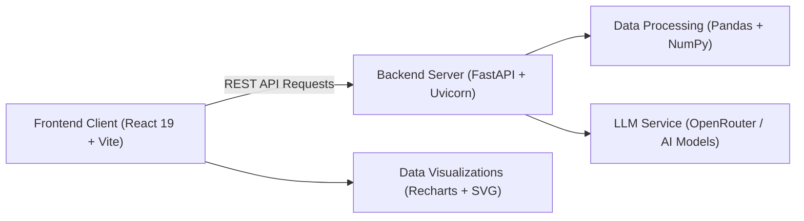

  

# InsightAI — Intelligent Data Analytics & Preprocessing Studio

> **Transform raw datasets into actionable insights. Clean data with interactive controls and generate rich statistical visualizations with AI guidance.**

---

### 🌐 Live Demo

🔗 **Live Demo:** [Explore InsightAI](https://insightai-nine.vercel.app)

---

## 📌 Overview

**InsightAI** is a full-stack, AI-augmented data analytics workspace built for analysts, researchers, and engineers. It replaces tedious notebook scripts with an intuitive interface where you can:

- 📁 **Upload any CSV** and instantly inspect statistical health signals.
- ⚙️ **Preprocess datasets** through an 11-step pipeline with live preview & rollback.
- 📊 **Generate 7 chart types** via manual controls or natural language prompts.
- 💬 **Ask questions** to an integrated LLM copilot and run queries in a live Pandas console.

---

## 🏗 Architecture & Tech Stack

## ✨ Key Features & Capabilities

### 1. 📊 Automated Profiling & Data Stories
- **Instant Health Check:** Automatic row/column counts, missing value heatmaps, duplicates, outlier detection, and data type inference.
- **AI Business Story:** Generates context on what rows represent and likely domain goals without exposing raw data.
- **Column Explorer:** Deep dive into distributions, frequencies, unique values, and single-click column explanations.
- **Correlation Matrix:** Highlights top positive and negative numeric correlations at a glance.

---

### 2. 🛠 11-Step Preprocessing Pipeline
Clean data safely with an isolated working copy, live previews, undo/redo history, and CSV export.

| Category | Operations Supported |
| :--- | :--- |
| **Cleaning** | • **Missing Values:** Impute (mean, median, mode, custom) or drop rows/columns • **Duplicates:** Remove all, keep first, or keep last |
| **Structure** | • **Columns:** Rename, drop, reorder, or duplicate • **Data Types:** Safe cast to String, Int64, Float, DateTime, Boolean, Category |
| **Transforms** | • **Text:** Case conversion, trim whitespace, find & replace • **Numeric:** Min-max normalization, outlier clipping, rounding, binning • **Dates:** Extract Year/Month/Day, custom formatting, day shifting |
| **ML Prep** | • **Encoding:** One-Hot, Label, and Ordinal encoding • **Scaling:** Standard (Z-score), Min-Max, and Robust (IQR) scaling |
| **Controls** | • **Filter & Sort:** Multi-column sorting and conditional filtering • **Audit Trail:** Undo last action, redo, reset to original, and export cleaned CSV |

---

### 3. 📈 Visualization Studio
Create interactive charts with zoom, pan, fullscreen inspection, and multi-format exports (PNG, SVG, PDF, CSV).

- **7 Chart Types:**
  - 📊 **Bar Chart:** Category comparisons with aggregations (`sum`, `mean`, `count`, `min`, `max`)
  - 📈 **Line Chart:** Trends and chronological time-series
  - 🥧 **Pie Chart:** Proportions and composition
  - 🔵 **Scatter Plot:** Bi-variate relationships and clustering
  - 📉 **Histogram:** Bin intervals and distributions
  - 📦 **Box Plot:** Five-number statistical summary (Min, Q1, Median, Q3, Max, IQR)
  - 🌡 **Correlation Heatmap:** Multi-variable correlation grid
- **Dual Creation Modes:**
  - **Builder Mode:** Fine-grained manual control over axes, aggregations, and filters.
  - **Assistant Mode:** Prompt-to-chart AI engine converting plain English requests into charts.
- **Session Persistence:** Built visualizations remain saved as you navigate between tabs.

---

### 4. 🤖 AI Copilot & Pandas Console
- **Analyst Copilot:** LLM assistant grounded in your dataset’s summary to answer queries about trends, anomalies, and insights.
- **Live Pandas Console:** Run arbitrary Pandas expressions (`df.describe()`, `df.groupby()`, etc.) directly on the DataFrame with instantaneous feedback.

---

* **Frontend:**
  * **React 19** & **Vite**
  * **Recharts** (Interactive charting engine)
  * **Axios** (REST API client with environment-aware baseURL)
  * **Neumorphic Glass Design System** (Full-page box components and responsive cards)
* **Backend:**
  * **FastAPI** & **Uvicorn**
  * **Pandas** & **NumPy** (Vectorized data processing and statistical analysis)
  * **Pydantic** (Request and schema validation)
  * **OpenRouter / LLM APIs** (Context-aware natural language processing with deterministic NLP fallbacks)

### 💻 Technologies

- **Frontend:** React 19, Vite, Recharts, Axios
- **Backend:** Python FastAPI, Pandas, NumPy, Pydantic, Uvicorn
- **AI / LLM:** OpenRouter API with context-aware prompts & NLP fallbacks

---

## 👨‍💻 Project Team

| **Field** | **Student 1** | **Student 2** |
|---|---|---|
| **Name** | Devansh Gupta | Krishna Verma |
| **Roll No.** | 1240258159 | 1240258236 |
| **Batch** | BCADS-33 | BCADS-33 |
| **University** | SoCA, Babu Banarasi Das University | SoCA, Babu Banarasi Das University |
| **Subject** | Predictive Analytics | Predictive Analytics |
