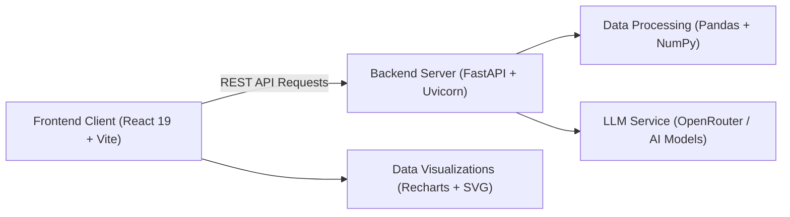

# InsightAI — Intelligent Data Analytics & Preprocessing Studio

> **Transform raw datasets into actionable executive insights, clean data with interactive Pandas controls, and generate rich statistical visualizations with AI guidance.**

---

### 🌐 Live Deployment

**👉 [LIVE PROJECT](https://insightai-nine.vercel.app) 👈**

---

## 📌 Executive Summary

**InsightAI** is a full-stack, AI-augmented data analytics platform designed for analysts, researchers, and engineers. It replaces complex notebook scripting with a clean, cohesive Neumorphic workstation where users can upload any CSV dataset, inspect statistical health signals, run an 11-step preprocessing pipeline with instant preview and rollback, generate 7 distinct chart types via manual or natural-language prompts, and chat with their data using an integrated LLM copilot and secure Pandas console.

---

## ✨ Key Features & Modules

### 1. 📊 Automated Workspace & Data Profiling
* **Instant Dataset Profiling:** Automatic row/column calculations, missing value maps, duplicate checks, outlier detection, and data type inference.
* **AI Data Story:** Generates concise business context explaining what each row represents, likely business domains, and domain objectives without exposing raw rows.
* **Interactive Column Explorer:** Deep-dive distributions, unique values, top frequencies, and one-line business explanations for any selected column.
* **Correlation Matrix Summary:** Top positive and negative numeric relationships with correlation coefficients.

### 2. 🛠 Data Cleaning & Preprocessing Workstation
A robust 11-operation preprocessing pipeline with an **isolated working copy**, **instant live preview**, **apply commit**, **undo/redo stack**, and **full CSV export**:
* **Missing Values:** Mean, Median, Mode, custom value imputation, or row/column dropping.
* **Duplicates:** Exact duplicate removal, keep first, keep last, or drop all duplicate occurrences.
* **Column Operations:** Rename, remove, reorder (first/last/left/right), or duplicate columns.
* **Data Types:** Safe type casting to String, Integer (`Int64`), Float, DateTime, Boolean, or Category.
* **Text Operations:** Lowercase, uppercase, title case, whitespace trimming, and string replacement.
* **Numeric Operations:** Min-max normalization, outlier clipping (percentiles or custom thresholds), rounding, and quantile binning.
* **Date Operations:** Year/Month/Day extraction, date formatting (`YYYY-MM-DD`, `DD/MM/YYYY`, etc.), and day shifting.
* **Feature Encoding:** One-Hot encoding, Label encoding, and Ordinal encoding.
* **Feature Scaling:** Standard Scaler (Z-Score), Min-Max Scaling, and Robust Scaler (IQR-based).
* **Sorting & Filtering:** Multi-column sorting (ascending/descending) and conditional filtering (`equals`, `contains`, `greater than`, `less than`, `is empty`, `is not empty`).
* **Transformation History:** Full action log tracking with one-click **Undo Last**, **Redo**, **Reset to Original**, and **Cleaned CSV Export**.

### 3. 📈 Visualization Studio
Interactive visualization studio supporting **7 statistical chart types** with full zoom, pan, fullscreen inspection, and 4 export formats (PNG, SVG, PDF, CSV):
* **Supported Charts:**
  * **Bar Chart:** Category comparisons with aggregations (`sum`, `mean`, `count`, `min`, `max`).
  * **Line Chart:** Chronologically sorted trends and time-series progressions.
  * **Pie Chart:** Category proportions and composition analysis.
  * **Scatter Plot:** Bi-variate numeric relationships and clustering.
  * **Histogram:** Distribution frequencies and bin intervals.
  * **Box Plot:** Five-number statistical summary (Min, Q1, Median, Mean, Q3, Max, IQR).
  * **Correlation Heatmap:** Color-coded multi-variable correlation matrix grid.
* **Dual Creation Modes:**
  * **Builder Mode:** Precise parameter control over X-axis, Y-axis, aggregation, grouping, and filters.
  * **Assistant Mode:** Conversational prompt-to-chart engine that converts natural-language queries into structured visualization plans with dataset-aware suggestions.
* **Session Persistence:** Built charts and custom titles persist across navigation tabs.

### 4. 🤖 Copilot Chat & Python Pandas Console
* **Analyst Chat:** Conversational LLM assistant equipped with dataset profiles and context to answer questions about trends, distributions, and anomalies.
* **Live Pandas Console:** Interactive execution sandbox to run arbitrary Pandas commands (`df.describe()`, `df.groupby()`, etc.) directly against the uploaded DataFrame.

---

## 🏗 Architecture & Tech Stack

* **Frontend:**
  * **React 19** & **Vite**
  * **Recharts** (Interactive charting engine)
  * **Axios** (REST API client with environment-aware baseURL)
  * **Neumorphic Glass Design System** (Full-page box components and responsive cards)
* **Backend:**
  * **FastAPI** & **Uvicorn**
  * **Pandas** & **NumPy** (Vectorized data processing and statistical analysis)
  * **Pydantic** (Request and schema validation)
  * **OpenRouter / LLM APIs** (Context-aware natural language processing with deterministic NLP fallbacks)

---
## 👨‍💻 Built By:

| **Field** | **Details** |
|---|---|
| **Student** | Devansh Gupta | Krishna Verma |
| **Roll No** | 1240258159 | 1240258236 |
| **Batch** | BCADS-33 |
| **University** | Babu Banarasi Das University |
| **Subject** | Predictive Analytics |

